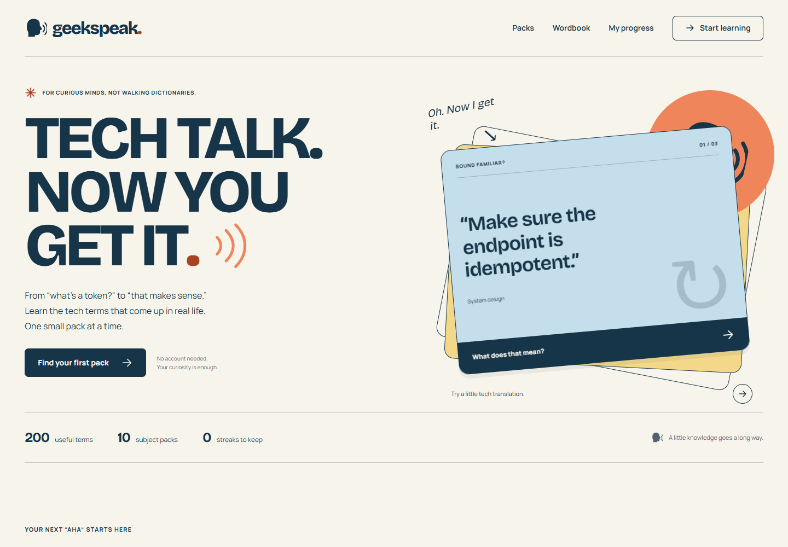
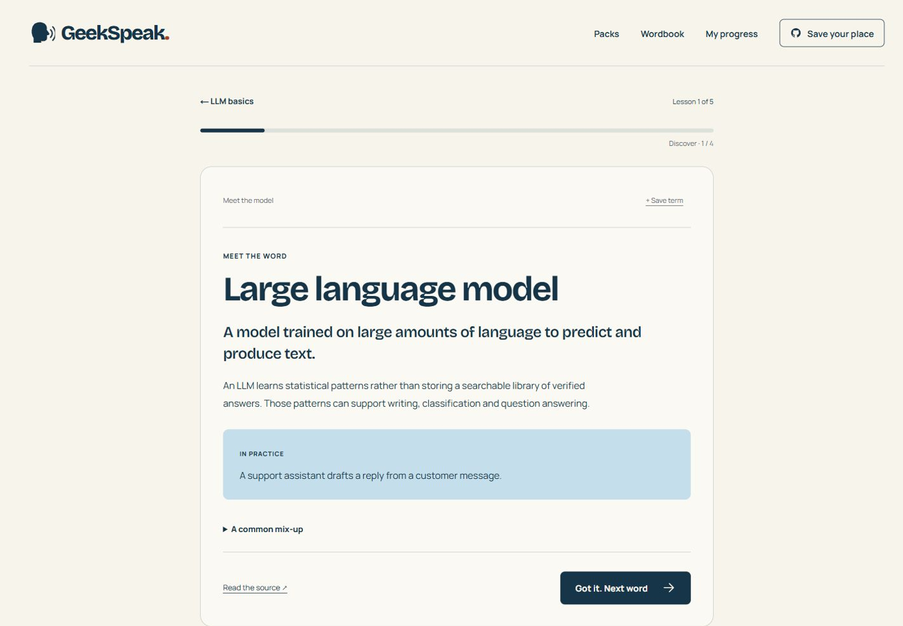
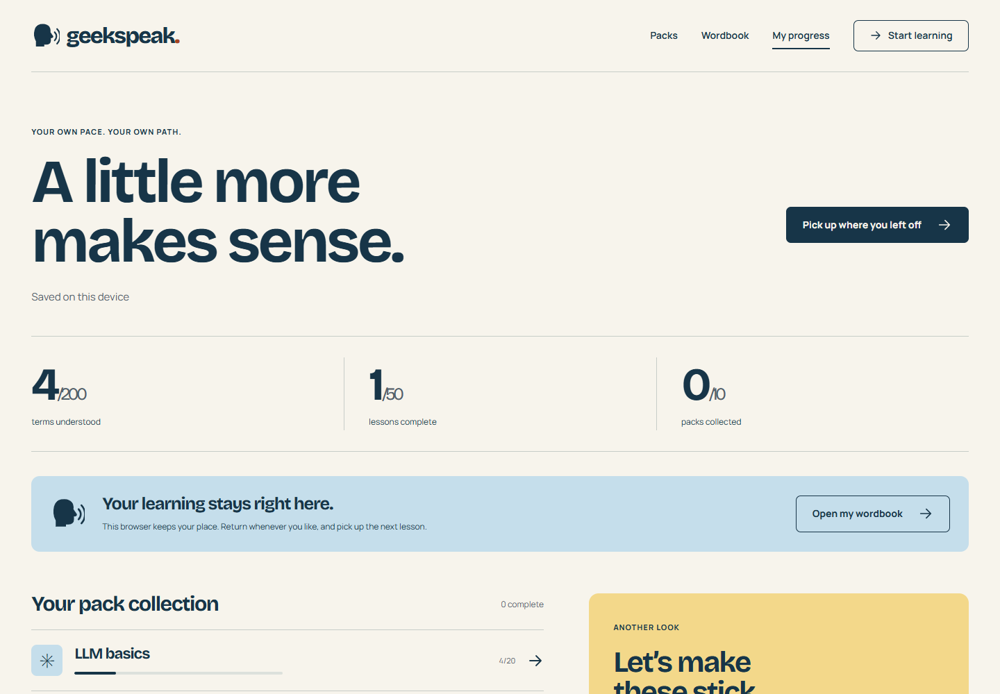

<div align="center">

<a href="#get-started">
  
</a>

# GeekSpeak

### Get the tech talk.

Learn the AI, coding and cloud terms that come up in real conversations. One small pack at a time.

[](https://github.com/holsoma/geekspeak/actions/workflows/checks.yml)
[](#the-packs)
[](#the-packs)
[](LICENSE)

**Free and open source · Learn without an account · No streaks**

[Features](#features) · [Setup guide](docs/SETUP.md) · [Contribute](CONTRIBUTING.md) · [Report an issue](https://github.com/holsoma/geekspeak/issues)

[Open GeekSpeak](https://geek-speak.vercel.app)

GeekSpeak runs on Vercel with a dedicated Neon database. GitHub sign-in is enabled, and cloud saving and the optional leaderboard have passed production integration checks. The final real-account sign-in check is pending. You can also learn without an account.

</div>

## A look inside



<table>
  <tr>
    <td width="50%" valign="top">
      <a href="docs/screenshots/lesson.png"></a>
    </td>
    <td width="50%" valign="top">
      <a href="docs/screenshots/progress.png"></a>
    </td>
  </tr>
</table>

Screenshots show the working website with local guest progress. Select either preview to view the full page.

## Features

|                                | What you can do                                                                                                                                 |
| ------------------------------ | ----------------------------------------------------------------------------------------------------------------------------------------------- |
| **Learn in small packs**       | Choose a subject, learn four terms, then answer questions about realistic situations. Each pack has five lessons.                               |
| **Understand the context**     | Read an original explanation, a practical example and a common misunderstanding for every term. Follow links to the original documentation.     |
| **Choose your starting point** | Open any pack. Follow its lesson path, or answer all four questions correctly to test out of a lesson.                                          |
| **Keep your progress**         | Guest progress stays in the browser. Configured GitHub sign-in saves progress across devices, with an explicit option to import guest progress. |
| **Build a wordbook**           | Search names, aliases and summaries. Save terms and filter by subject.                                                                          |
| **Review what needs work**     | Questions you miss return during the lesson. Your review list keeps track of terms that still need another look.                                |
| **Join a small leaderboard**   | Opt in to show your GitHub username and points. Each distinct term answered correctly while signed in earns ten points once.                    |

There are no streaks, hearts, speed bonuses, subscriptions or invented leaderboard entries.

## The packs

| Pack                   | A few of the ideas inside                                                |
| ---------------------- | ------------------------------------------------------------------------ |
| LLM basics             | Tokens, context windows, attention, fine-tuning and hallucinations.      |
| RAG & search           | Chunking, embeddings, retrieval, ranking and grounded answers.           |
| AI agents              | Tools, planning, memory, hand-offs and prompt injection.                 |
| Machine learning       | Training data, overfitting, leakage, baselines and generalisation.       |
| Deep learning & vision | Neural networks, backpropagation, convolution and image representations. |
| AI in production       | Evaluation, serving, quantisation, drift and consistent inputs.          |
| Python & its tools     | Coroutines, NumPy, pandas, PyTorch, FastAPI and testing.                 |
| Data & databases       | SQL, transactions, ACID, indexes and Apache Spark.                       |
| System design          | Idempotency, caching, queues, replication and failure handling.          |
| AWS & cloud            | EC2, S3, Lambda, IAM, containers and Terraform.                          |

Each pack contains 20 selected terms. This is a practical vocabulary, not an exhaustive dictionary or an official course syllabus.

## Get started

<details open>
<summary><strong>Run locally</strong></summary>

Use Node.js 22 or later:

```powershell
npm ci
Copy-Item .env.example .env.local
npm run dev
```

Open [localhost:4400](http://localhost:4400). All packs, lessons, term pages and guest progress work without credentials.

For a production preview:

```powershell
npm run build
npm run start -- --hostname 127.0.0.1 --port 4400
```

</details>

For your own deployment, GitHub sign-in, cloud saving and the leaderboard require a dedicated OAuth app and a PostgreSQL connection. Until configured, the interface explains that account saving is unavailable. It does not simulate a login or publish guest scores. See the [setup and deployment guide](docs/SETUP.md).

## Documentation

| Guide                                 | Contents                                                                   |
| ------------------------------------- | -------------------------------------------------------------------------- |
| [Setup and deployment](docs/SETUP.md) | Environment variables, GitHub OAuth, Neon, migrations and Vercel.          |
| [Architecture](docs/ARCHITECTURE.md)  | Content structure, lesson rules, progress merging and leaderboard scoring. |
| [Contributing](CONTRIBUTING.md)       | Development checks and improvements to the explanations.                   |
| [Design](DESIGN.md)                   | Visual concept, colours, typography and accessibility targets.             |

## Development checks

The [quality review](docs/QUALITY.md) records the independent scores, browser measurements and remaining limitations.

```powershell
npm test
npm run build
# With the production server running at 127.0.0.1:4400:
npm run test:e2e
```

The browser checks cover guest lessons, saved terms, retries, test-out, persistence and mobile navigation. Account integration checks use temporary encrypted test sessions to verify persistence, account separation, rejected unauthenticated and cross-origin writes, scoring and leaderboard participation. A real GitHub sign-in must also complete before the OAuth flow is described as verified. See the [deployment status](docs/DEPLOYMENT.md) for the latest results.

## Built with

[Next.js](https://nextjs.org/), [React](https://react.dev/) and [TypeScript](https://www.typescriptlang.org/). [GSAP](https://gsap.com/) handles the card motion. [Auth.js](https://authjs.dev/) handles GitHub sign-in, and [Neon PostgreSQL](https://neon.com/) stores account progress. The public website runs on [Vercel](https://vercel.com/).

## Credits and licence

Original code, explanations, questions and SVG artwork use the [MIT licence](LICENSE). [Bricolage Grotesque](https://fonts.google.com/specimen/Bricolage+Grotesque) and [Manrope](https://fonts.google.com/specimen/Manrope) use the SIL Open Font Licence. Next.js downloads and serves the fonts locally.

[TechTerms](https://techterms.com/) informed the dictionary and quiz functionality. [Table Tales](https://tabletales.crz.studio/) and [House of Giants](https://houseofgiants.com/) informed the visual references. Their code, artwork and definitions are not included.

GeekSpeak is not affiliated with those sites, GitHub, AWS, the referenced software projects or any educational institution. Technical explanations link to their sources; third-party documentation retains its own terms.
